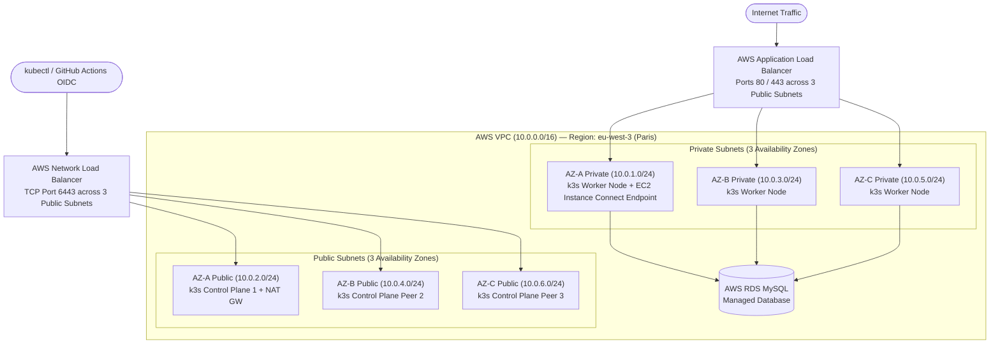

# Multi-AZ High-Availability Kubernetes (k3s) Infrastructure on AWS

Production-style AWS cloud networking and multi-Availability Zone Kubernetes (`k3s`) infrastructure provisioned end-to-end with **Terraform**, paired with passwordless **GitHub Actions OIDC** continuous deployment for a full-stack React + Bun/Express + AWS RDS MySQL application.

---

## Architecture Diagram



---

## Key Engineering Highlights

- **Multi-AZ Network Segmentation:** Custom VPC (`10.0.0.0/16`) spanning 3 Availability Zones (`eu-west-3a`, `eu-west-3b`, `eu-west-3c`) with 3 Public Subnets and 3 Private Subnets, Regional NAT Gateway, and custom Route Tables.
- **Zero-Bastion Private Node Access:** Private worker nodes have no public IPs; SSH access is secured strictly through an **AWS EC2 Instance Connect Endpoint (EICE)** in private subnet AZ-A and least-privilege Security Groups.
- **Dual Load Balancing Architecture:**
  - **Network Load Balancer (NLB):** Load-balances Kubernetes API traffic (`TCP 6443`) across control-plane nodes with dynamic TLS SAN registration.
  - **Application Load Balancer (ALB):** Routes external `HTTP/HTTPS` (`80/443`) ingress traffic to private worker nodes running Traefik Ingress.
- **Remote Terraform State with Locking:** Uses an encrypted **AWS S3 backend** (`backend.tf`) with **DynamoDB state locking** (`terraform-state-locks`) to prevent concurrent state corruption.
- **Passwordless AWS OIDC Deployment:** GitHub Actions assumes an IAM role via OpenID Connect (`aws-actions/configure-aws-credentials`), dynamically whitelists the runner's public IP on port `6443`, rolls out the new image, verifies `kubectl rollout status`, and revokes the security group rule in an `always()` cleanup block.

---

## How to Run

### 1. Initialize Terraform with Remote S3 State
```bash
cd F:/projects/devops/projects/personal-1
terraform init
```

### 2. Provision the Multi-AZ AWS Cluster
```bash
terraform apply -auto-approve
```

### 3. Deploy the Full-Stack Todo Application Manifests
```bash
kubectl apply -f yamls/todo-backend-manifest.yaml
kubectl apply -f yamls/todo-frontend-manifest.yaml
kubectl apply -f yamls/ingress.yaml
```

---

## Verified Results & Outcomes

| Metric / Verification | Result |
| :--- | :--- |
| **Availability Zones** | **3 AZs** (`eu-west-3a`, `eu-west-3b`, `eu-west-3c`) with **6 Subnets** (3 public, 3 private) |
| **Provisioning Time** | **~4 minutes** end-to-end (`terraform apply` + cloud-init automated `k3s` bootstrap) |
| **CI/CD Rollout Time** | **~2 minutes** via GitHub Actions OIDC (`build` -> `push` -> `kubectl rollout status`) |
| **Worker Node Failure Test** | Terminating 1 worker EC2 instance verified automatic Pod rescheduling onto healthy AZ worker nodes with zero ingress downtime behind the ALB |
